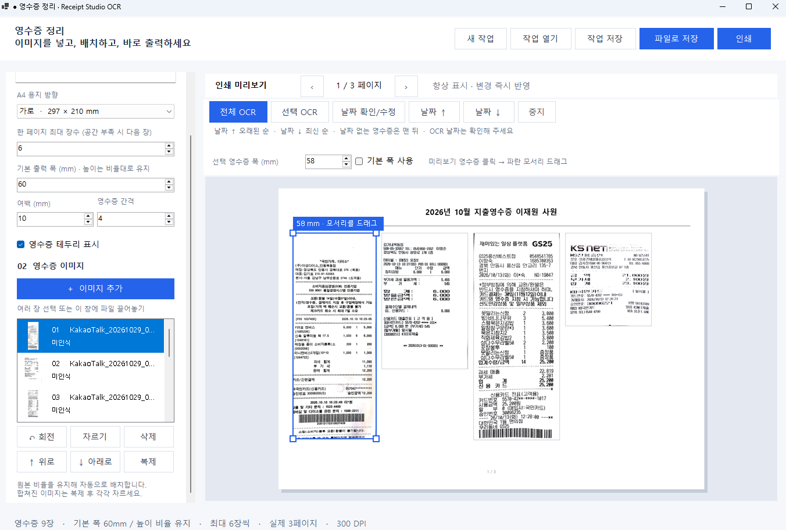
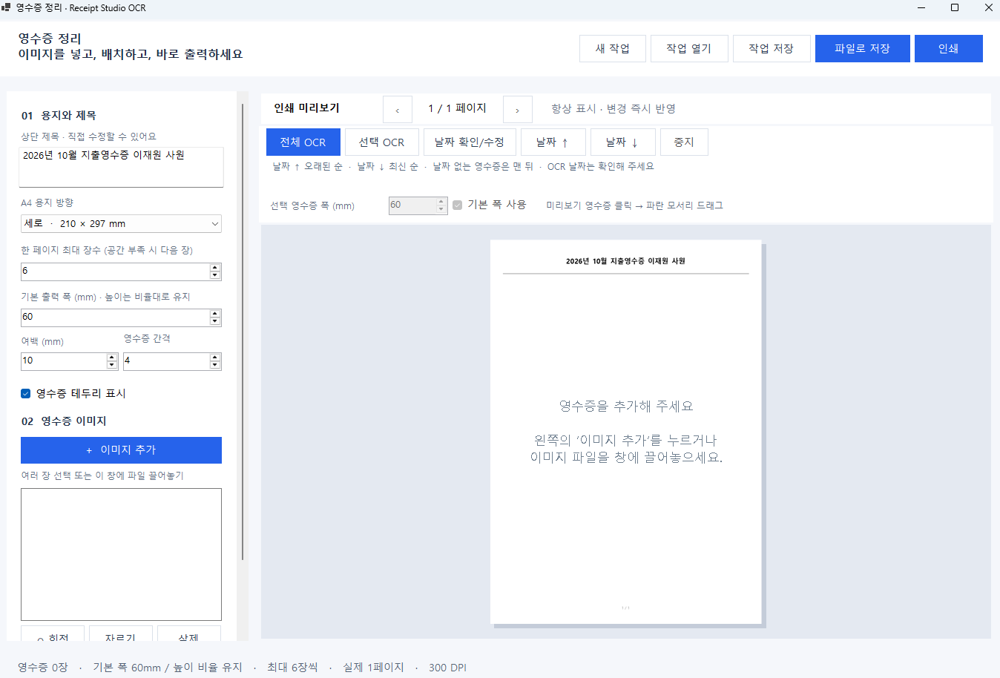
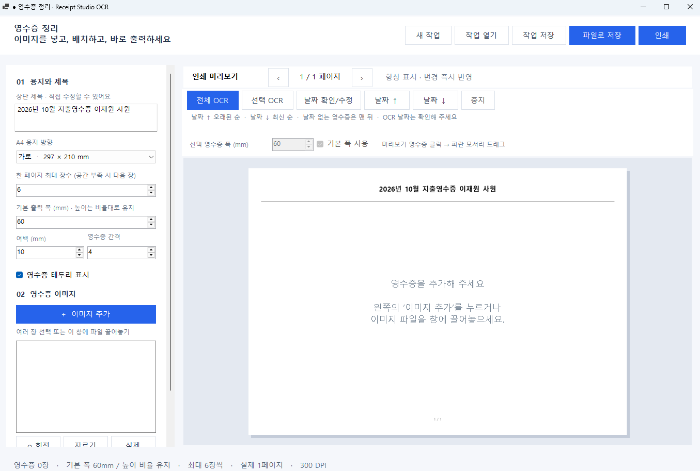

# Receipt Studio · 영수증 정리

영수증 사진을 불러와 A4에 배치하고, 결제일 순으로 정리한 뒤 인쇄하거나 PDF·PNG·JPEG로 저장하는 **Windows 데스크톱 프로그램**입니다.

오른쪽에 인쇄 미리보기가 항상 표시됩니다. 영수증마다 원래 비율을 유지하며, 미리보기에서 직접 클릭하고 모서리를 드래그해 출력 크기를 조절할 수 있습니다. 한글·영어 OCR 엔진이 포함되어 있어 영수증 인식도 PC 안에서 처리합니다.

**[실행 파일 다운로드](https://github.com/dpfmaptm1534/Receipt-Studio/releases/download/v4.0.0/ReceiptStudio-v4.exe)** · **[전체 배포 ZIP](https://github.com/dpfmaptm1534/Receipt-Studio/releases/download/v4.0.0/ReceiptStudio-v4-win-x64.zip)** · **[릴리스 목록](https://github.com/dpfmaptm1534/Receipt-Studio/releases)**



## 다운로드와 실행

1. 위의 **실행 파일** 또는 **전체 배포 ZIP**을 다운로드합니다.
2. ZIP을 받았다면 먼저 압축을 풀고 `ReceiptStudio-v4.exe`를 실행합니다.
3. **이미지 추가**를 누르거나 영수증 파일을 창에 끌어놓습니다.
4. 용지 방향·제목·크기를 조절한 뒤 **파일로 저장** 또는 **인쇄**를 누릅니다.

| 항목 | 내용 |
| --- | --- |
| 운영체제 | Windows 10 / 11, 64비트(x64) |
| 실행 형태 | 설치 마법사 없는 EXE, .NET 8 런타임 포함 |
| 인터넷 | 영수증 편집·OCR·내보내기에는 필요 없음 |
| OCR | Tesseract 및 한국어·영어 학습 데이터 포함 |
| 추가 구성 요소 | PC에 따라 Microsoft Visual C++ 2015–2022 재배포 패키지(x64) 필요 |
| 배포본 | 약 179MiB EXE, 사용방법 및 타사 라이선스를 함께 담은 ZIP 제공 |

OCR 구성 요소를 불러오지 못하면 [Microsoft 공식 Visual C++ x64 재배포 패키지](https://aka.ms/vs/17/release/vc_redist.x64.exe)를 설치한 뒤 다시 실행하세요. 실행 파일은 코드 서명되지 않았습니다.

GitHub의 **Code → Download ZIP**은 소스 다운로드입니다. 실행만 하려면 **Releases의 EXE 또는 배포 ZIP**을 받으세요. 실행 파일은 GitHub의 일반 Git 파일 크기 제한(100MiB)을 초과하므로 Release 첨부 파일로 배포합니다.

## 주요 기능

| 기능 | 설명 |
| --- | --- |
| 항상 보이는 미리보기 | 설정 변경을 즉시 반영하고 여러 페이지를 앞뒤로 확인 |
| A4 방향 선택 | 세로 210×297mm / 가로 297×210mm |
| 제목 편집 | 기본값 `2026년 10월 지출영수증 이재원 사원`, 직접 수정 가능 |
| 자동 배치 | 원본 비율과 출력 폭을 유지하고 공간이 부족하면 다음 페이지로 이동 |
| 페이지당 최대 개수 | 1~24장 설정, 기본 6장 |
| 개별 크기 조절 | 미리보기 모서리 드래그 또는 mm 단위 숫자 입력 |
| 이미지 편집 | 회전, 영역 자르기, 복제, 삭제, 위·아래 순서 이동 |
| 결제일 OCR | 한국어·영어 인식, 날짜 후보 확인 및 직접 수정 |
| 날짜 정렬 | 오래된 순 / 최신 순, 날짜 미지정 항목은 맨 뒤 |
| 출력 | 전체 페이지 PDF, 300 DPI PNG/JPEG, 프린터 인쇄 |
| 작업 저장 | 이미지·배치·날짜 정보를 포함하는 `.receipt` 파일 |

## 화면

### A4 세로 미리보기



### A4 가로 미리보기



### 영수증별 크기 조절


화면의 파란 테두리·모서리 조절점·크기 안내는 편집용 표시입니다. 인쇄나 저장 파일에는 포함되지 않습니다.

## 사용 방법

### 1. 영수증 이미지 추가

**이미지 추가**에서 여러 파일을 선택하거나 프로그램 창에 파일을 끌어놓습니다.

- 지원 입력: PNG, JPG/JPEG, BMP, TIF/TIFF, GIF.
- 가져온 이미지는 프로그램 안에서 편집하며 원본 파일은 변경하지 않습니다.
- TIFF의 여러 페이지나 GIF의 모든 프레임을 각각 가져오는 기능은 없습니다.
- PDF 파일을 직접 가져오는 기능은 없습니다.

여러 영수증이 이미 한 이미지에 합쳐져 있다면 이미지를 추가하고 **복제**한 뒤, 각 항목에서 **자르기**로 영수증 하나씩 남기세요. 자동으로 영수증 영역을 분리하는 기능은 현재 없습니다.

### 2. 용지와 제목 설정

왼쪽 **용지와 제목**에서 아래 값을 바꿉니다.

| 설정 | 범위 / 기본값 |
| --- | --- |
| 상단 제목 | 직접 편집, 최대 100자 |
| A4 용지 방향 | 세로 또는 가로 |
| 한 페이지 최대 장수 | 1~24장 / 기본 6장 |
| 기본 출력 폭 | 30~150mm / 기본 60mm |
| 여백 | 5~25mm / 기본 10mm |
| 영수증 간격 | 0~12mm / 기본 4mm |
| 영수증 테두리 | 표시 여부 선택 |

**페이지당 장수는 최대치입니다.** 6장으로 정해도 영수증 크기에 따라 한 페이지에 3~4장만 들어갈 수 있습니다. 남은 영수증은 다음 페이지에 배치됩니다. 작은 글씨가 더 작아지는 것을 피하기 위해 지정 개수에 맞춰 일괄 축소하지 않습니다.

### 3. 영수증 크기 조절

**마우스로 조절하기**

1. 오른쪽 미리보기 안에서 조절할 영수증을 클릭합니다.
2. 파란 테두리의 모서리 네모를 잡고 드래그합니다.
3. 바깥으로 끌면 커지고 안쪽으로 끌면 작아집니다. 원래 가로·세로 비율은 유지됩니다.
4. 드래그 중 표시되는 출력 폭(mm)을 확인합니다.
5. 마우스를 놓으면 새 크기로 전체 배치를 다시 계산합니다. 공간이 부족하면 다음 페이지로 이동할 수 있습니다.

드래그 중 **Esc**를 누르면 취소됩니다. 빈 곳을 클릭하면 선택이 해제됩니다.

**숫자로 정확하게 조절하기**

영수증을 선택하고 미리보기 위의 **기본 폭 사용** 체크를 해제한 뒤 **선택 영수증 폭(mm)**을 바꿉니다. 예를 들어 일반 영수증은 60mm, 글씨가 작은 휴대폰 캡처는 75mm로 지정할 수 있습니다. 다시 **기본 폭 사용**을 체크하면 왼쪽 기본 출력 폭을 따릅니다. 마우스로 크기를 조절하면 이 체크는 자동 해제됩니다.

기본 폭을 바꿔도 개별 폭을 지정한 영수증은 해당 값을 유지합니다. 사진의 픽셀 수만으로 실제 종이 폭이나 글자 크기를 알 수 없으므로, 내용에 맞게 직접 조절하세요.

**아주 긴 영수증**은 출력 폭을 유지한 채 여러 페이지에 나누어 배치하고 조각 번호를 표시합니다. 한 부분의 크기를 바꾸면 해당 영수증 전체에 적용됩니다. 이미지 기준으로 분할하므로 글자 줄 사이를 자동 판별해 자르지는 않습니다.

### 4. OCR로 결제일 읽고 정렬

1. **전체 OCR**을 누릅니다. 한 장만 인식하려면 선택 후 **선택 OCR**을 누릅니다.
2. 목록의 날짜와 인식 상태를 확인합니다. 자동 인식한 날짜는 추정값입니다.
3. **날짜 확인/수정**에서 영수증 이미지, 날짜 후보, 전체 인식 텍스트를 확인합니다.
4. 결제일을 직접 입력하거나 후보를 선택하고 **날짜 적용**을 누릅니다. 날짜 체크를 해제하면 날짜 미지정으로 저장됩니다.
5. **날짜 ↑**는 오래된 순, **날짜 ↓**는 최신 순으로 정렬합니다.

날짜가 없는 항목은 양쪽 정렬에서 모두 맨 뒤에 놓이고, 같은 날짜끼리는 기존 순서를 유지합니다. 정렬은 미리보기와 인쇄·파일 출력에도 반영됩니다.

직접 적용한 날짜는 OCR을 다시 실행해도 유지됩니다. 이미지를 자르면 기존 날짜와 OCR 정보는 초기화됩니다. **중지**는 현재 이미지 인식이 끝난 뒤 남은 인식을 멈춥니다.

OCR은 날짜 후보를 읽고 결제일을 추정합니다. 흐림·기울어짐·희미한 인쇄·여러 날짜가 있는 사진에서는 잘못 읽거나 확인이 필요할 수 있습니다. `11/09/2026`처럼 월/일 순서가 애매한 날짜는 직접 확인하세요. 여러 영수증이 합쳐진 이미지도 개별 영수증으로 잘라 인식하는 것이 좋습니다.

현재 구조화해서 자동 추출하는 항목은 **결제일**입니다. 상호와 금액은 전체 OCR 텍스트에서 참고할 수 있지만 별도 필드 추출·합계 계산·엑셀 내보내기는 지원하지 않습니다.

### 5. 파일 저장과 인쇄

| 버튼 / 형식 | 결과 |
| --- | --- |
| 파일로 저장 → PDF | 전체 페이지를 하나의 PDF로 저장 |
| 파일로 저장 → PNG | 300 DPI 이미지, 여러 페이지면 `_01`, `_02` 등의 번호 추가 |
| 파일로 저장 → JPEG | 300 DPI 이미지, 여러 페이지면 번호 추가 |
| 인쇄 | Windows 인쇄 대화상자에서 프린터와 페이지 범위 선택 |
| 작업 저장 | 나중에 수정할 수 있는 `.receipt` 파일 저장 |

PDF는 출력용 이미지 기반 문서이며 검색 가능한 텍스트 레이어는 포함하지 않습니다. 프린터는 A4 용지를 사용하고, 인쇄 불가능 영역을 고려해 기본 여백 10mm부터 확인하세요. 실제 용지 출력은 프린터 드라이버 설정에 따라 차이가 날 수 있습니다.

### 6. 작업 저장과 다시 열기

**작업 저장**으로 만든 `.receipt`에는 영수증 이미지, 순서, 제목, 용지 설정, 개별 출력 폭, OCR 텍스트·후보 날짜·확인한 결제일이 함께 들어갑니다. 원본 사진이 없는 다른 PC에서도 **작업 열기**로 이어서 편집할 수 있습니다.

`.receipt`는 내부적으로 `project.json`과 PNG 이미지가 들어 있는 ZIP 형식입니다. 기존 버전에서 저장한 작업도 열 수 있고, 개별 폭 정보가 없는 작업은 기본 폭 60mm로 시작합니다.

## 자주 묻는 질문

**영수증 글씨가 너무 작아요.**  
해당 영수증을 클릭한 뒤 모서리를 바깥으로 드래그하거나 선택 출력 폭을 늘리세요. 필요하면 가로 용지를 쓰고 페이지당 최대 장수를 낮추세요. 원본 자체가 흐린 사진은 확대해도 선명해지지 않습니다.

**6장을 선택했는데 한 페이지에 6장이 안 들어가요.**  
최대 장수와 실제 출력 크기를 함께 적용하기 때문입니다. 공간이 부족하면 다음 페이지에 놓습니다. 더 많이 넣으려면 폭·여백·간격을 줄이되 글씨 크기를 확인하세요.

**OCR을 실행할 때 처음만 시간이 걸려요.**  
첫 인식 시 포함된 엔진과 학습 데이터를 `%LOCALAPPDATA%\ReceiptStudio\ocr-5.2.0`에 풀어 캐시하고 무결성을 확인합니다. 인터넷에서 모델을 내려받는 작업은 아닙니다.

**실행 파일이 왜 큰가요?**  
.NET 런타임, 네이티브 OCR 엔진, 한국어·영어 학습 데이터를 포함하기 때문입니다. 별도 .NET SDK는 실행에 필요하지 않습니다.

**영수증이 서버로 올라가나요?**  
프로그램은 영수증 이미지를 외부 서버에 전송하지 않습니다. OCR·편집·저장은 로컬에서 처리합니다. `.receipt`와 출력 파일에는 영수증 내용이 들어갑니다.

## 소스에서 빌드

Windows x64와 **.NET 8 SDK**가 필요합니다. 처음 NuGet 패키지를 복원할 때 인터넷이 필요합니다. OCR 학습 데이터와 라이선스는 이 저장소에 포함되어 있습니다.

```powershell
git clone https://github.com/dpfmaptm1534/Receipt-Studio.git
cd Receipt-Studio
dotnet restore -r win-x64
dotnet publish -c Release -r win-x64 --self-contained true -p:PublishSingleFile=true -p:IncludeNativeLibrariesForSelfExtract=true -o build-ocr --no-restore
```

결과는 `build-ocr\ReceiptStudio.exe`입니다. 공개 v4 배포본은 이 실행 파일을 `ReceiptStudio-v4.exe`로 이름을 바꿔 제공합니다. `build.ps1`로도 복원·빌드를 실행할 수 있습니다.

```powershell
.\build.ps1
```

### 검증

빌드 후 아래 명령으로 레이아웃·마우스 상호작용·프로젝트 저장과 실제 OCR 테스트를 실행합니다.

```powershell
dotnet bin\Release\net8.0-windows\win-x64\ReceiptStudio.dll --self-test
dotnet bin\Release\net8.0-windows\win-x64\ReceiptStudio.dll --ocr-test
Get-Content bin\Release\net8.0-windows\win-x64\test-output\result.txt
Get-Content bin\Release\net8.0-windows\win-x64\test-output\ocr-result.txt
```

v4 검증 결과: 레이아웃·상호작용 등 **4,553개 검사**, OCR·날짜·정렬·저장 **27개 검사** 통과. 세로·가로 배치, 겹침과 경계, 출력 폭과 원본 비율, 긴 영수증 분할의 원본 구간 연속성, 네 모서리 드래그 및 취소, 작업 저장 후 복원, 이미지·PDF 생성, 합성 한글 영수증의 실제 OCR을 포함합니다. 실제 종이 인쇄는 프린터별 별도 확인이 필요합니다.

### 소스 구성

| 경로 | 역할 |
| --- | --- |
| `Program.cs` | WinForms 화면, 이미지 편집, 저장·인쇄 흐름 |
| `LayoutEngine.cs` | mm 기준 자동 배치, 페이지 렌더링, PDF 생성 |
| `PreviewInteraction.cs` | 미리보기 선택, 드래그 크기 조절, 취소 |
| `ReceiptOcr.cs` | OCR 엔진 준비, 날짜 후보 해석, 정렬 |
| `OcrControls.cs` | OCR 실행과 날짜 확인·수정 UI |
| `ProjectFile.cs` | `.receipt` 프로젝트 저장·불러오기 |
| `SelfTest.cs`, `InteractionTests.cs`, `OcrTests.cs` | 레이아웃·상호작용·OCR 검사 |
| `LayoutSample.cs` | 개발용 샘플 배치 생성 도우미 |
| `ocr-data/` | 한국어·영어 Tesseract 학습 데이터 |
| `licenses/` | 타사 구성 요소 라이선스와 고지 |
| `docs/screenshots/` | 실제 프로그램 스크린샷 3장 |

`bin/`, `obj/`, 빌드 임시 파일과 사용자 작업 파일은 Git에 포함하지 않습니다. 실행 배포본은 Releases에 있습니다.

## 배포 파일 무결성

Release의 `SHA256SUMS.txt`에 EXE와 ZIP의 SHA-256 값이 있습니다. PowerShell에서 다운로드한 파일의 값을 계산해 비교할 수 있습니다.

```powershell
Get-FileHash .\ReceiptStudio-v4.exe -Algorithm SHA256
Get-FileHash .\ReceiptStudio-v4-win-x64.zip -Algorithm SHA256
```

## 사용 기술과 타사 라이선스

| 구성 요소 | 버전 / 데이터 | 라이선스 |
| --- | --- | --- |
| .NET / Windows Forms | .NET 8 | Microsoft .NET의 해당 라이선스 적용 |
| [Tesseract .NET wrapper](https://github.com/charlesw/tesseract) | 5.2.0 | Apache-2.0 |
| [Tesseract OCR](https://github.com/tesseract-ocr/tesseract) | 5.2.0 | Apache-2.0 |
| [tessdata_fast](https://github.com/tesseract-ocr/tessdata_fast) | `kor`, `eng`, 2026-10-29 받은 데이터 | Apache-2.0 |
| [Leptonica](https://github.com/DanBloomberg/leptonica) | 1.82.0 | BSD 계열 |
| [InteropDotNet](https://github.com/AndreyAkinshin/InteropDotNet) | wrapper에 포함 | MIT |

상세 고지와 원문은 [licenses/NOTICE.txt](licenses/NOTICE.txt) 및 [licenses 폴더](licenses/)에 있습니다. 해당 고지는 배포 ZIP과 실행 파일의 리소스에도 포함됩니다. 이 저장소의 자체 코드에는 별도의 프로젝트 라이선스를 지정하지 않았으며, 타사 구성 요소의 라이선스가 자체 코드 전체에 자동 적용되는 것은 아닙니다.

버전별 변경 사항은 [CHANGELOG.md](CHANGELOG.md), 간단한 사용 안내는 [사용방법.txt](사용방법.txt)를 참고하세요.
